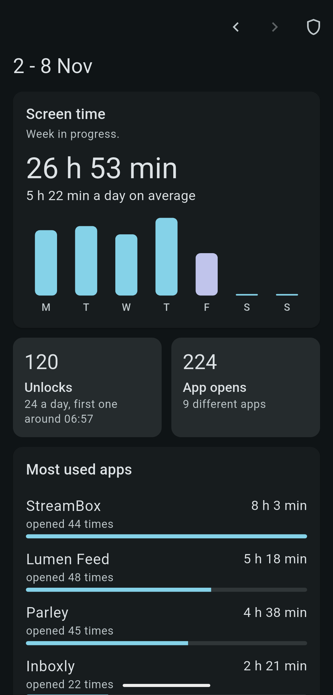
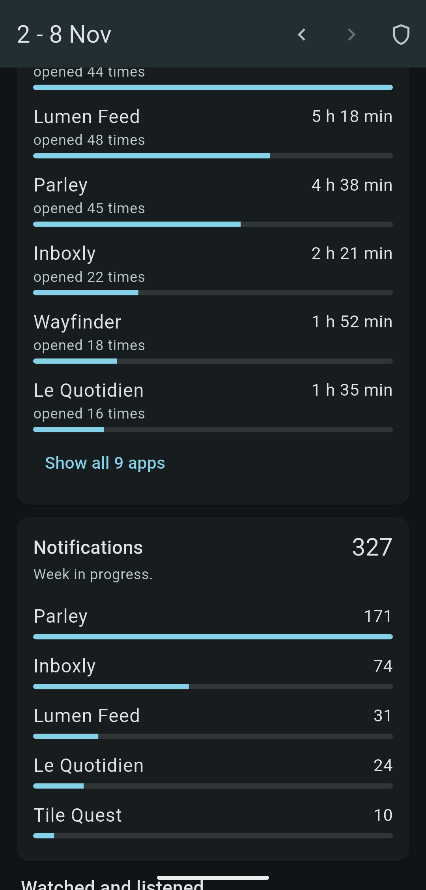
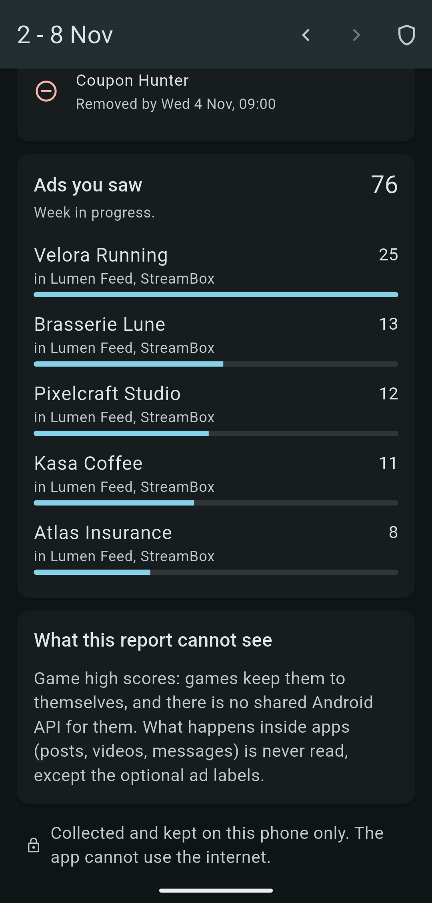
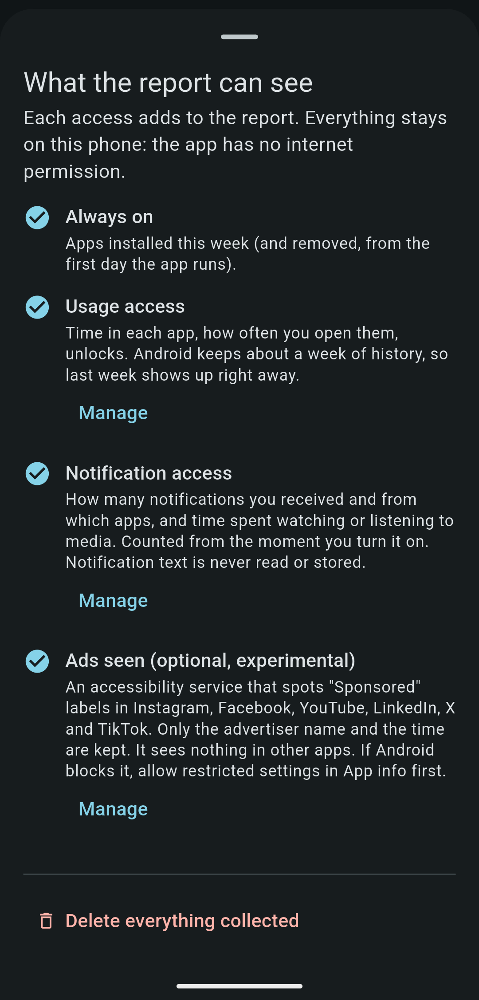
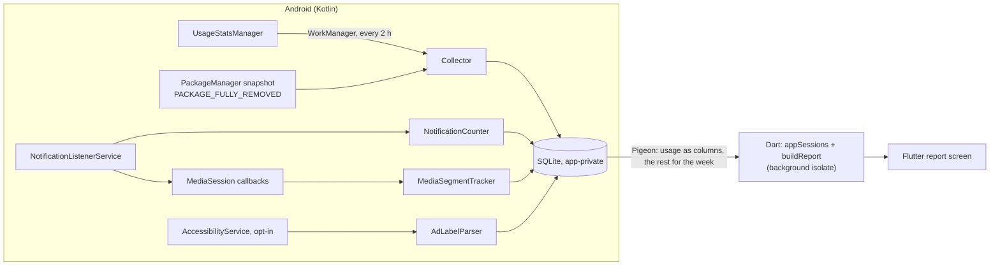

# Weekly Lens

> Status: technical test for Aurendor (Mobile Developer), tested on an Android 17 phone.
> Last checked: 2026-11-06

An Android app that shows you a report of your week on your phone: time in each app, how often
you picked the phone up, notifications, apps installed and removed, video and audio played and,
if you opt in, the ads you scrolled past. All of it is collected and kept on the phone. The app
has no internet permission.

All data in these screenshots is fictional. They come from the built-in demo mode
(`--dart-define=DEMO=true`): the apps, advertisers, times and counts are generated, and nothing
was taken from a real person's phone.

| Your week | Most used apps | Ads you saw | What it can see |
|---|---|---|---|
|  |  |  |  |

## The question, and my reading of it

> "A user would like to be able to review what they did and saw on their phone during the week.
> What trade-offs would you make to offer them a solution that is comprehensive, efficient
> and/or practical, and why?"

The three words pull in different directions, and the platform decides most of the answer.
What a phone lets one app learn about the others is limited on purpose: the more a metric tells
about the user, the stronger the permission it needs, and some metrics have no source at all.
So my answer is a tiered design: the report works with no special access, each access the user
grants adds metrics, and the report always says what it measured and since when.

- Practical: nothing is mandatory. One screen, one week, tap to go back a week.
- Efficient: no foreground service and no polling. The system calls us (notification and media
  callbacks), a WorkManager job copies usage history every 2 hours, and the report is computed
  in a background isolate.
- Comprehensive: the hard metrics ("what did I see?") are opt-in and labelled as experimental,
  because they need a much more invasive access.

Assumptions I made:

- One user, one Android phone, the user's own device. The app is installed from this repository
  (sideloaded), not from Google Play. Where Play policy would change a decision, it is noted.
- A week is Monday 00:00 to Monday 00:00 in the phone's local time.
- The report is for the user only. No account, no server, no sync, no analytics.
- Android first. iOS gets its own section below because its rules lead to a different design.

## What is measured, how, and what I gave up

Measured on an Android 17 (API 37) test phone.

| Metric | Source | Access | History on first run | Notes and trade-off |
|---|---|---|---|---|
| Time per app, total screen time | `UsageStatsManager.queryEvents` (activity resumed/paused, screen off, shutdown) | Usage access | About 9 days on the test phone (measured on the first run, not assumed) | Matches Android's own totals within seconds, see [validation](#does-it-measure-the-right-thing) |
| App opens | Derived from the sessions above | Usage access | Same | My own definition (an app coming to the front from another app or a screen off), so it runs higher than Android's `appLaunchCount`. A close is the end of a session (another app, the home screen or the screen turning off), so closes equal opens and are not shown twice |
| Unlocks, first pickup | `KEYGUARD_HIDDEN` events | Usage access | Same | The first pickup ignores unlocks before 04:00, which belong to the night before |
| Apps installed | `PackageInfo.firstInstallTime` | None | Yes, 30 days | Uses a launcher-intent `<queries>` instead of `QUERY_ALL_PACKAGES`, which Play reserves for apps whose core purpose needs the full inventory |
| Apps removed | `ACTION_PACKAGE_FULLY_REMOVED` broadcast, plus a diff of inventory snapshots | None | No | Android keeps no trace of a removal. The broadcast gives the exact time; the snapshot diff catches what the broadcast missed and is shown as "removed by" |
| Notifications received | `NotificationListenerService` | Notification access | No, counted from the moment access is granted | An update re-posts the same key, so only new keys count. Ongoing, foreground-service and group-summary notifications are status, not messages, and are skipped. Notification text is never read |
| Video and audio time | `MediaSessionManager` playback states (allowed by the same notification access) | Notification access | No | Covers players that publish a media session (most video and music apps). Video vs audio comes from the app's declared category or a short list of known players. Videos playing inline in a feed often have no session and are missed. Status: built and unit tested, not yet seen working on the device |
| Ads seen, top advertiser | Opt-in `AccessibilityService` reading a short allowlist of feed apps | Accessibility (opt-in) | No | Spots "Sponsored / Sponsorisé / Gesponsord" labels and keeps the advertiser name next to them. The brief asks for the product; the advertiser is the closest answer the screen gives reliably, because the brand sits next to the label while the product only appears in the ad's free text, which is not read. Heuristic, breaks when an app changes its layout. Status: a short scroll through a feed on the device recorded sponsored posts; whether every advertiser name is right has not been checked yet. Play would require a permission declaration and would very likely refuse it, so this is a sideload or research-panel feature |
| Game high scores | None | | | Not built. Games keep their scores to themselves, and Play Games leaderboards are per game and need each game's own ID. Faking it would be worse than saying so in the app |
| Content watched or read | Screen content | | | Not built. Reading what is on screen in every app is surveillance, even locally. The ads module is the one narrow exception, opt-in and limited to labels |

## Architecture



- Kotlin collects, Dart decides. The Android side stores raw facts and never aggregates. Every
  rule that turns events into numbers lives in pure Dart (`lib/src/domain`), so it is tested
  without a device and the rules can change without losing history.
- Pigeon generates a typed contract (`pigeons/activity_api.dart`) instead of a hand-written
  `MethodChannel` with string keys. Heavy calls run on a background task queue.
- A report needs two weeks and a day of usage events (the comparison, and sessions that started
  before Monday), about 35,000 on the test phone. They cross the bridge as typed arrays plus one
  table of package and class names, not one object per event; two event types the report does
  not read stay in the store; notifications, media, installs and ads come for the shown week
  only. Together these took loading from 330 to 350 ms to 200 ms on the first open and 70 to
  120 ms after that. Building the report takes 60 to 115 ms on a background isolate.
- Nothing touches SQLite on the main thread: the listener and the ads observer write through
  their own single-thread executor, the database runs in WAL mode so the report's reads do not
  block them, and the worker, a manual sync and the delete button share one lock.
- The collector keeps its own copy of usage events because Android only keeps about a week.
  Rows older than 8 weeks are pruned. On the test phone, 9 days of usage events take about 7 MB.
- No state-management package: one `ChangeNotifier` drives one screen. No chart package either:
  the bars are a few `DecoratedBox`es. Fewer dependencies, less to audit.

Code map:

| Path | What |
|---|---|
| `android/.../collect/` | Collector, notification and media listener, ads observer, SQLite store |
| `android/.../bridge/` | Pigeon host implementation |
| `lib/src/domain/` | Week boundaries, event-to-session rules, weekly report |
| `lib/src/data/` | Platform source (Pigeon) and seeded demo source |
| `lib/src/ui/` | Report screen, access sheet |
| `tool/compare_usage.dart` | Runs the session rules on an exported table, used for the validation below |
| `docs/decisions.md` | Each decision with the alternative and why |

## Privacy

This is the part I would defend first, because the data is about everything the user does.

- No `INTERNET` permission in the release build, removed from the merged manifest with
  `tools:node="remove"` so a library cannot add it back. Checked on the built APK:

  ```
  $ aapt2 dump permissions app-release.apk
  uses-permission: name='android.permission.PACKAGE_USAGE_STATS'
  uses-permission: name='android.permission.WAKE_LOCK'
  uses-permission: name='android.permission.ACCESS_NETWORK_STATE'
  uses-permission: name='android.permission.RECEIVE_BOOT_COMPLETED'
  uses-permission: name='android.permission.FOREGROUND_SERVICE'
  ```

  The last four come from WorkManager. Debug builds do get `INTERNET`, which Flutter needs for
  hot reload.
- Data stays in app-private storage. Cloud backup and device-to-device transfer are excluded
  (`android:allowBackup="false"` and `data_extraction_rules.xml`).
- Minimum data: notification text, media titles and screen text are never stored. The ads
  observer keeps the advertiser name and a time. The system only sends it events from six feed
  apps (`packageNames` in `ad_observer.xml`), and the service also checks that the screen it is
  about to read belongs to the app that sent the event: a late event must not lead to reading
  a banking app that has just come to the front.
- One button deletes everything collected. Each source that is still switched on restarts its
  history from that moment, so the next sync does not quietly re-import the week Android still
  keeps.

## Does it measure the right thing?

I checked the session rules against Android's own numbers rather than against my intuition:
the events collected on the test phone were run through `appSessions` with
`tool/compare_usage.dart`, and the time per app for one day was compared with the in-memory
daily stats of `adb shell dumpsys usagestats` (`totalTimeUsed`) for the same window.

- Time per app matched within seconds for 9 of the 10 most used apps. One app came out about
  a minute short, and I have not found why yet.
- Opens run a little higher than Android's `appLaunchCount` for apps that move between their own
  screens with a pause longer than 2 seconds. The merge gap is one constant to tune.

The figures themselves stay on the phone: they describe a real person's day, and this
repository is public.

## Tests

The rules are written test first, one test per rule with its cases in a table.

```
$ flutter test
00:00 +10: All tests passed!

$ cd android && ./gradlew :app:testDebugUnitTest
UsageColumnsBuilderTest      tests=1 failures=0
AdLabelParserTest            tests=3 failures=0
InventoryDiffTest            tests=1 failures=0
MediaSegmentTrackerTest      tests=1 failures=0
NotificationCounterTest      tests=2 failures=0

$ flutter analyze
No issues found!
```

- Dart: week boundaries (including the 167 h and 169 h weeks of a clock change), events to
  sessions (overlapping activities, screen off, shutdown, missing pauses), the weekly report
  (clipping at day and week edges, notifications, installs, media, ads, coverage, comparison
  with the previous week), and decoding the columns the bridge sends.
- Kotlin: notification dedupe and filters, media play/pause segments, inventory diff, the ad
  label parser, its dedupe, the rule that only an observed app's own screen is read, and the
  packing of usage events into columns.
- I checked that the week test catches the classic bug: with `start.add(Duration(days: 7))`
  the autumn week ends on Sunday 23:00 and the test fails.
- No UI tests, by choice: the logic is where the risk is.

## Run it

Requirements: Flutter 3.44 or newer, an Android phone on Android 10 (API 29) or newer.

```sh
flutter build apk --release
adb install -r build/app/outputs/flutter-apk/app-release.apk
```

Open the app and tap the shield icon to turn on each access. Android sends you to the right
settings page. When an app is installed from a file, Android 13+ may grey out Notification
access and Accessibility as "restricted settings": open App info, the three-dot menu, "Allow
restricted settings", then try again.

From a computer, the same accesses can be granted with adb (this is how the test phone was set
up; the last command replaces the list of enabled accessibility services, so add any existing
ones to it):

```sh
adb shell appops set app.weeklylens GET_USAGE_STATS allow
adb shell cmd notification allow_listener app.weeklylens/app.weeklylens.collect.ActivityNotificationListener
adb shell settings put secure enabled_accessibility_services app.weeklylens/app.weeklylens.collect.AdObserverService
```

Demo data, on any device or the desktop, with nothing collected:

```sh
flutter run --dart-define=DEMO=true
```

## iOS: a different design, not a port

iOS answers the same question with a different contract. Screen Time data (`DeviceActivity`)
gives per-app duration, pickups and notifications, but only to a report extension that runs in a
sandbox: it cannot make network requests or hand the data back to the app. So on iOS:

- the report itself must be a SwiftUI view rendered by a `DeviceActivityReport` extension,
  shown inside the Flutter app as a platform view;
- the app can never read the numbers, so no custom aggregation in Dart, no export;
- installs, removals, media time and ads have no source at all;
- distribution needs Apple's Family Controls entitlement.

That is a stronger privacy guarantee than mine, enforced by the OS rather than by a missing
permission, and a weaker report. I would build it as a separate, smaller feature set rather than
pretend both platforms are equal.

## What I would do next

- Check media time and the ads parser over a full week of normal use, and compare the ad names
  with what I actually saw.
- Find the minute missing on one app in the validation, and check opens against Digital Wellbeing.
- Roll raw events older than a few weeks into daily totals to cap storage.
- Pair events into sessions on the Kotlin side and ship about 5,000 sessions instead of 35,000
  events, once the session rules have settled (they would then need their tests in Kotlin).
- Record when a source is switched off. Coverage today starts when a source first connected, so
  a listener turned off for four days in the middle of a week still reads as complete.
- Skip the reload when the app comes back to the front a few seconds after the last one.
- Weekly notification ("your week is ready") on Monday morning, generated on the device.
- Encrypt the database at rest (SQLCipher) if the phone's own encryption is not considered
  enough for the target users.
- A research-panel variant (explicit consent, export the user reviews and sends themselves),
  which is the only setting where the ads module makes sense at scale.

## License

[EUPL-1.2](LICENSE).
